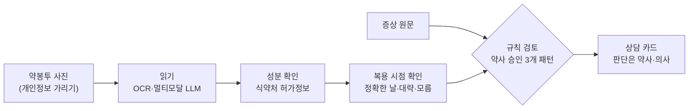

# 알짜약

약의 시작·변경 시점과 새 증상을 정리해 약사·의사 상담을 준비하도록 돕는 AI 상담 준비 도우미

> [!NOTE]
> 2026 모두의 AI 실험실 AI 서비스 개발 프로젝트(과학기술정보통신부·한국지능정보사회진흥원) 신청을 위해 정리한 기획 문서입니다. 아직 구현 코드는 없습니다.

> [!WARNING]
> 이 저장소의 내용은 의료 조언이 아닙니다. 약을 끊거나 바꾸는 일은 반드시 의사·약사와 상의하세요.

## 한눈에 보기

| 항목 | 내용 |
|---|---|
| 분야 | 보건의료 |
| 사용자 | 여러 약을 먹는 어르신의 보호자(1차 사용자), 어르신(기록의 당사자이자 함께 확인하는 사람), 약사·의사(결과를 검토하는 사람) |
| 해결할 문제 | 약을 시작·변경한 시점과 새 증상이 상담 자리에 빠지거나 틀린 시점으로 전달돼, 처방 연쇄 같은 약 관련 문제를 놓치기 쉬움 |
| 핵심 기능 | 약봉투 인식·성분 확인 → 실제 복용 시점 확인('모름' 허용) → 증상 원문 기록 → 약사가 승인한 3개 패턴 대조 → 한 장 상담 카드 |
| 하지 않는 것 | 원인 확정·진단, 위험 점수·확률, 중단·감량·대체약 권고, 건강 효과 주장 |
| 형태 | 설치 없이 링크로 여는 모바일 웹 |

## 왜 필요한가

약의 이상반응이 새 질환으로 오인되어 그 증상을 치료하는 약이 더해지는 것을 **처방 연쇄**라고 합니다. 혈압약(칼슘채널차단제)을 먹은 뒤 생긴 발목 부종에 이뇨제가 추가되는 경우가 대표적입니다. 추가된 약이 꼭 필요한 경우도 있어서, 해당 여부는 약사·의사가 판단해야 합니다.

문제는 그 판단에 필요한 정보가 상담 자리에 잘 오지 않는다는 점입니다.

- 약은 여러 병원·약국에서 받고, 약봉투의 조제일은 실제로 먹기 시작한 날과 다릅니다.
- 부종·떨림·어지러움 같은 증상은 나이 탓으로 넘기기 쉽습니다.
- 건보공단 제출자료를 인용한 보도에 따르면, 만성질환으로 10종 이상 약을 60일 이상 복용하는 사람은 2025년 6월 약 171만 명이고 그중 80.6%가 65세 이상입니다.
- 건강정보 이해능력이 '적절' 수준인 비율은 70세 이상에서 36.0%로, 20대(70.5%)의 절반 수준입니다(2023 국민건강영양조사).

## 무엇을 만드나

처음부터 넓게 만들지 않고 **약봉투 양식 1종, 검토 패턴 3개, 상담 카드 1장**으로 시작합니다.

1. **약 정보 확인** — 약봉투를 찍으면 약 이름·함량·복용법·문서 날짜를 읽고, 식약처 의약품 제품 허가정보로 성분을 연결합니다. 확정하지 못한 약은 분석하지 않습니다.
2. **복용 시점 확인** — 새로 시작한 약인지, 다시 받은 약인지, 중단 후 재복용하거나 용량을 바꾼 것인지 묻습니다. 날짜는 정확한 날·대략적 시기·모름 중에서 고르고, 정보의 출처(문서·본인·보호자)를 남깁니다.
3. **증상 기록** — 어르신이 말한 표현을 그대로 남기고, 시작·악화 시기를 함께 적습니다.
4. **정해진 범위 검토** — 약사가 승인한 3개 패턴만 대조합니다. 날짜 순서나 처방 목적이 불확실하면 판단을 보류합니다.
5. **상담 카드** — 약·함량, 문서 날짜와 실제 복용 시점, 증상 경과, 확인되지 않은 정보, 근거 출처, 약사·의사에게 물어볼 질문 1\~2개를 한 장에 담습니다.

검토하는 3개 패턴은 다음과 같습니다.

| 처음 먹은 약 | 생길 수 있는 증상 | 이어서 추가되기 쉬운 약 |
|---|---|---|
| 칼슘채널차단제(암로디핀 등, 혈압약) | 부종 | 루프이뇨제 |
| 가바펜틴·프레가발린 | 부종 | 이뇨제 |
| 메토클로프라미드·레보설피리드(위장약) | 파킨슨 증상 | 레보도파 |

결과는 위험/안전 두 가지로 나누지 않고 **상담할 경과 있음 · 추가 정보 필요 · 검토 범위에서 후보 없음** 세 가지로만 보여 줍니다. '후보 없음'에도 검토하지 못한 약과 빠진 정보를 함께 적어 안전 보장으로 읽히지 않게 합니다.

## AI는 어디에 쓰나

AI는 의료 판단을 하는 데 쓰지 않고, 형식이 제각각인 약봉투와 일상 표현을 정리하는 부담을 줄이는 데 씁니다.

| 하는 일 | 맡는 쪽 |
|---|---|
| 약봉투에서 약 이름·함량·날짜 읽기 | OCR·멀티모달 LLM. 읽지 못한 값은 '확인 필요'로 표시 |
| 제품 → 성분 확인 | 식약처 의약품 제품 허가정보 API와 규칙 |
| "발이 퉁퉁 부었어" 같은 말 정리 | LLM. 원문을 보존하고 부정 표현이 뒤집히지 않았는지 검사 |
| 날짜 선후관계·패턴·예외 판단 | 규칙(일반 소프트웨어). 약사가 승인한 근거만 사용 |
| 카드의 질문 문장 | LLM이 승인된 근거 안에서만 다듬고, 검증에 실패하면 고정 문장 사용 |
| 치료 변경·진단 | 하지 않음. 의사·약사가 판단 |

LLM은 새로운 처방 연쇄를 만들어 내지 않습니다. 외부 모델에는 이름·생년월일 등 식별정보를 가린 뒤 필요한 부분만 보냅니다.

## 기존 서비스와의 관계

DUR은 처방·조제 때 금기·중복·용량 등을 점검하고, '내가 먹는 약! 한눈에'는 투약 이력을 보여 주며, 다제약물관리사업은 전문가가 약 전체를 검토합니다. MyTherapy·Dosetrail·Posology 같은 앱은 약과 증상을 기록해 보고서를 만들고, 공개 프로젝트 [CascadeGuard](https://github.com/JeffreySardella/CascadeGuard)는 약 목록을 처방 연쇄 목록과 대조해 의사에게 가져갈 카드를 만듭니다.

알짜약은 이런 선행 사례를 인정하고, 아래 네 가지가 실제 상담에 더 도움이 되는지를 **검증할 가설**로 둡니다.

1. 한국 약봉투의 약을 성분까지 정확히 연결한다.
2. 문서 날짜와 실제 복용 시점을 나누고, 모르는 날짜는 '모름'으로 남긴다.
3. 보호자와 어르신이 함께 확인한 경과를 약사가 바로 읽을 수 있는 한 장으로 만든다.
4. 전문가가 검토한 소수의 패턴과 예외로, 단순 약 목록보다 쓸모 있는 질문을 만든다.

## 검증 계획

| 대상 | 방법 |
|---|---|
| 기술 | 직접 재현한 약봉투 80\~120장과 약사 검토를 받을 합성 사례 100건(개발용·평가용 분리)으로 추출 정확도, 성분 연결, 날짜 판단, 질문의 근거 일치를 측정. 보류된 사례도 함께 공개 |
| 의료인 | 약사·의사 등 최소 2명(목표 3명 이상)이 같은 사례를 기존 방식의 약 목록과 알짜약 카드로 번갈아 보며 핵심 정보 파악 시간과 상담 준비의 유용성을 평가. 한 사람당 40분 안팎, 비대면 |
| 어르신·보호자 | 보호자 중심 5\~6명씩 두 차례(총 10\~12명)가 합성 사례로 입력부터 카드까지 사용. 결과를 원인 확정이나 약 변경 허용으로 오해하는지 점검하고, 1차에서 찾은 문제를 고쳐 2차에서 다시 확인 |

핵심 지표는 '의료인이 상담 준비에 유용하다고 평가하고, 사용자가 결과를 잘못 해석하지 않은 카드의 비율'입니다. 실제 건강정보는 동의 절차와 디지털의료제품 해당 여부 확인을 마친 뒤에만 다룹니다. 낙상·입원 감소 같은 건강 효과는 주장하지 않습니다.

## 문서

| 문서 | 내용 |
|---|---|
| [docs/application.md](docs/application.md) | 신청서 본문(2026-10-08 제출 직전 수정본 기준) |
| [docs/project-plan.md](docs/project-plan.md) | 기획 상세: 문제 정의, MVP, AI 활용, 선행 사례, 규제·개인정보·지식재산, 검증 계획, 8주 계획, 예상 질문, 수치 해석 |
| [docs/research-review.md](docs/research-review.md) | 심층 리서치·타당성 검토 보고서(팀원이 생성형 AI를 활용해 작성, 2026-10-07) |
| [docs/references.md](docs/references.md) | 참고 자료 |

## 팀

SSAFY 16기 교육생 4명이 함께 기획했습니다. 역할은 ① 문서 인식·성분 매칭, ② 날짜·규칙·데이터, ③ 증상 정리·카드·근거 연결, ④ 화면·통합·사용성 시험으로 나눴고, 약학 검토가 필요한 규칙과 카드 문구는 외부 약사 자문으로 검증할 계획입니다.
