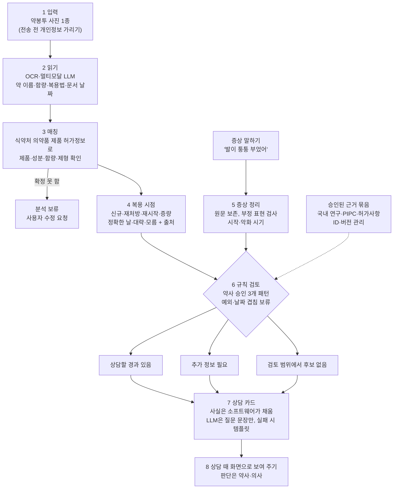

# 알짜약 기획 상세

팀 기획 문서(2026-10-07)를 옮기고, 검증 인원은 2026-10-08 신청서 수정본에 맞췄습니다. 표본 수와 목표치는 계획 단계의 제안값입니다. 근거 자료는 [references.md](references.md)에, 이 기획의 바탕이 된 검토 보고서는 [research-review.md](research-review.md)에 있습니다.

> [!WARNING]
> 이 문서는 서비스 기획이며 의료 조언이 아닙니다. 약을 끊거나 바꾸는 일은 반드시 의사·약사와 상의하세요.

## 1. 한눈에 보기

| 항목 | 내용 |
|---|---|
| 프로젝트명 | 알짜약 — 어르신의 약 시작·변경 시점과 새 증상을 보호자와 함께 정리해, 처방 연쇄 가능성을 약사·의사에게 물어볼 수 있게 돕는 AI 상담 준비 도우미 |
| 분야 | 보건의료 |
| 누가 쓰나 | 1차 사용자는 여러 약을 먹는 어르신의 보호자. 어르신은 기록의 당사자이자 함께 확인하는 사람. 약사·의사는 결과를 검토하는 사람 |
| 해결할 문제 | 약을 시작·변경한 시점과 새 증상이 상담 자리에 빠지거나 틀린 시점으로 전달돼, 처방 연쇄 같은 약 관련 문제를 놓치기 쉬움 |
| 핵심 기능 | 약봉투 1종 인식·성분 확인 → 실제 복용 시점 확인('모름' 허용) → 증상 원문 기록 → 약사가 승인한 3개 패턴 대조 → 한 장 상담 카드 |
| AI가 하는 일 | 약봉투 구조화, 생활 언어 증상 정리, 승인된 근거 안에서 질문 문장 다듬기. 판정은 규칙이 하고 AI는 연쇄를 만들지 않음 |
| 하지 않는 것 | 원인 확정·진단, 위험 점수·확률, 중단·감량·대체약 권고, 건강 효과(낙상·입원 감소) 주장 |
| 차별점 | 비슷한 선행 사례(CascadeGuard 등)가 있음을 인정. 한국 약봉투→성분 연결, 문서 날짜와 실제 복용 시점 분리, 보호자·어르신 공동 확인, 약사용 한 장 요약이 더 유용한지를 검증할 가설로 둠 |
| 이름 | '알짜'(꼭 필요한 것)와 '알약'을 합친 이름 |

## 2. 왜 이 문제인가

처방 연쇄는 실제 약물안전 문제입니다. 다만 판단은 약사·의사가 해야 하고, 그 판단에 필요한 정보(어떤 약을 언제 시작·변경했고 그 뒤 어떤 증상이 생겼는지)가 상담 자리에 잘 오지 않습니다. 알짜약은 이 정보의 빈틈을 겨냥합니다.

### 2.1 처방 연쇄: 약의 이상반응이 새 질환으로 오인될 때

- **정의:** 약의 이상반응을 새로운 질환으로 오인해 다른 약을 추가하는 과정입니다. Rochon·Gurwitz가 1995년 제시했고 1997년 BMJ 논문이 널리 인용됩니다. 최근에는 이상반응을 알고도 이익과 위험을 따져 일부러 약을 더하는 경우를 구분하므로, '부작용을 치료하는 약이 추가됨'이 모두 잘못된 처방은 아닙니다.
- **목록:** 국제 전문가 합의 목록으로 ThinkCascades(2022, 9개)와 PIPC(2025, 8개국 전문가 12명, 잠재적 부적절 연쇄 65개)가 있습니다. 환자를 진단하는 도구가 아니라 검토할 조합의 목록입니다.

MVP에서 다루는 3개 패턴과 근거입니다. 숫자는 연구 설계상의 연관성이고, 개별 환자의 인과를 확정하지 않습니다.

| 패턴 | 근거 | 숫자를 읽는 법 | 알짜약에서 주의할 점 |
|---|---|---|---|
| 칼슘채널차단제(암로디핀 등) → 부종 → 루프이뇨제 | 미국 청구자료, 신규 사용자 1,206,093명(JAMA Netw Open 2019). 처방순서 보정비 1.87, 추정 연쇄 분율 전체 1.44%·65세 이상 2.30% | 처방 순서 차이로 계산한 추정치이지 실측 유병률이 아님. 시작 전후 360일은 연구 분석창 | 심부전·신장질환 때문에 쓰는 이뇨제와 구별(추가 목적 질문) |
| 가바펜틴·프레가발린 → 부종 → 이뇨제 | 캐나다 온타리오 66세 이상 260,344명 코호트(2021). 90일 안 이뇨제 처방 2.0% 대 1.3%, 보정 HR 1.44 | 90일은 연구 관찰창이지 부종이 생기는 기한이 아님 | 용량 변경도 확인 |
| 메토클로프라미드·레보설피리드 → 파킨슨 증상 → 레보도파 | 국내 65세 이상 건강보험 자료 환자-대조군(Huh 외, J Clin Med 2019). 보정 오즈비 2.94/3.30, 20일 이상 노출군 4.14/10.24(10.24의 95% 신뢰구간 5.82–17.99) | 오즈비이지 '확률 10배'가 아님. 20일은 노출 기간이지 '복용 20일 뒤 발병'이 아님 | 실제 파킨슨병과의 감별은 앱이 하지 않음 |

- **다음 단계 후보와 제외:** 도네페질→요실금→항콜린제, ACE억제제→기침→진해제는 다음 단계 후보입니다. NSAIDs→혈압 상승→혈압약은 후순위입니다. NSAIDs+PPI는 위장 출혈을 막기 위한 적절한 병용일 수 있어 제외하고, 벤조디아제핀→인지 저하→치매약은 원 연구 근거를 확인하지 못해 제외합니다.
- **대응의 근거와 한계:** 네덜란드 2개 지역약국 개념검증(2025)에서 약사가 과거 연쇄 후보 24명 중 8명을 처방의와 논의해 3명을 되돌렸고, 신규 약 사용자 44명에게 약 1개월 뒤 연락해 이상반응 6명·개입 2건을 확인했습니다. 반면 MedSafer(5,698명)·SENATOR(1,537명) 무작위 시험에서는 약물 검토·권고를 늘려도 이상약물사건 감소를 입증하지 못했습니다. 좋은 탐지와 건강 개선 사이에는 전문가의 검토·수용·후속 관리가 필요합니다. 그래서 알짜약은 건강 효과를 주장하지 않고 상담 정보의 질을 목표로 합니다.

### 2.2 판단에 필요한 정보가 상담 자리에 잘 오지 않는다

- **조제일은 복용 시작일이 아닙니다:** 처방일, 조제일, 이번 복용 시작일, 최초 복용일, 재시작일, 용량 변경일이 모두 다릅니다. 5년째 먹던 약을 다시 받은 날을 새로 시작한 날로 보면 없는 선후관계가 생깁니다.
- **약이 여러 곳에서 옵니다:** 여러 병원·약국에서 약을 받으면 한 사람이 전체 약과 시작 시점을 한눈에 보기 어렵습니다. '내가 먹는 약! 한눈에'는 최근 1년 조제 이력을 보여 주지만 실제 복용 여부·재시작·일반약까지 보장하지는 않습니다.
- **증상은 나이 탓으로 넘기기 쉽습니다:** 노인의 이상반응은 부종·떨림·어지러움·피로처럼 뚜렷하지 않게 나타납니다.
- **다제약물은 고령층에 몰려 있습니다:** 건보공단 제출자료를 인용한 보도에 따르면, 만성질환이 1개 이상이면서 10종 이상 약을 60일 이상 복용한 사람은 2025년 6월 1,717,239명이고 그중 65세 이상이 1,384,209명(80.6%)입니다. 전체 노인의 80.6%가 10개 이상 먹는다는 뜻이 아니고, 처방 자료이지 실제 복용을 확인한 수치가 아닙니다.
- **정보 이해가 가장 어렵습니다:** 건강정보 이해능력 '적절' 수준은 70세 이상 36.0%, 20대 70.5%입니다(질병관리청, 2023 국민건강영양조사, 2025년 발표). 65–85세 1,102명 조사(2017–2018)에서는 13.2%가 복약정보 이해에 어려움을 겪었고, 만성질환이 3개 이상이면 그 오즈가 높았습니다(조정 오즈비 2.28, 한국보건사회연구원 2020).
- **디지털 격차:** 만 55세 이상 고령층의 디지털정보화 역량은 일반 국민을 100으로 볼 때 56.2이고, AI 서비스 경험률은 30.2%(일반 국민 59.4%)입니다(NIA 2025 디지털정보격차 실태조사). 55세 이상 결과라 75세 이상 다제약물 환자의 사용성으로 그대로 옮기지 않습니다. 1차 사용자를 보호자로 두는 이유입니다.

### 2.3 지금 있는 체계와 남는 빈틈

| 체계 | 하는 일 | 알짜약과의 관계 |
|---|---|---|
| DUR | 처방·조제 때 병용금기, 연령·임부금기, 성분·효능군 중복, 용량·투여기간·노인주의 점검 | 안전 점검의 강력한 기존 기반. 다만 '약 → 새 증상 → 새 약' 경로를 별도 점검 항목으로 확인하지는 못함 |
| 내가 먹는 약! 한눈에·나의건강기록 | 본인 투약 이력 조회·내려받기·공유 | 자료원. 실제 복용·최초 시작일은 보장하지 않음. 개발자가 개인 약력을 받는 공개 API는 확인하지 못함 |
| 지역약국·의료기관 | 문진, 약력 확인, 이상반응 상담, 처방의와 조정 | 문제를 해결하는 주체. 알짜약은 이 상담의 입력·전달을 돕는 보조 도구 |
| 건보공단 다제약물관리사업 | 지역·병원 모형의 전문 약물 검토(2018년 시작, 2026년에도 시범사업) | 전문 검토와 겹침. 대체가 아니라 상담 전 정보 정리로 연계할 수 있는지 검증 |
| 방문약사·통합돌봄(2026.3.27 시행) | 가정 방문에서 보관 약·실제 사용·복용의 어려움 확인 | 실증 협력 후보. 법 시행이 모든 지역의 서비스 제공을 뜻하지는 않음 |

## 3. 무엇을 만드나 (MVP)

보호자가 어르신과 함께 쓰는 모바일 웹입니다. 처음부터 넓게 만들지 않고 **문서 형식 1종, 검토 패턴 3개, 상담 카드 1장**으로 시작합니다. 의료기기 해당 여부가 정해지기 전까지 개인별 분석은 합성 사례로만 검증합니다.

### 3.1 이용 흐름

1. **약 정보 확인:** 약봉투나 처방전 중 한 가지 양식을 찍으면 약 이름·함량·복용법·문서 날짜를 읽고, 식약처 의약품 제품 허가정보로 성분을 연결합니다. 원문 확대 화면과 함께 제품명·성분·함량을 나란히 보여 주어 직접 고치게 하고, 확정하지 못한 약은 분석하지 않습니다. '확인' 버튼만 누르는 것을 검증으로 치지 않습니다.
2. **복용 시점 확인:** 문서 날짜를 곧바로 복용 시작일로 보지 않습니다. "이번에 새로 받은 약인가요, 계속 먹던 약인가요?", "증상이 생기기 전부터 먹었나요?" 같은 짧은 질문으로 신규·재처방·재시작·증량을 구분하고, 날짜는 정확한 날·대략적 시기·모름 중에서 고릅니다.
3. **증상 기록:** 어르신의 말을 그대로 남기고 시작·악화 시기를 함께 적습니다. AI가 정리한 표현은 사용자가 확인합니다.
4. **경과 검토:** 약사가 승인한 3개 패턴만 대조합니다. 결과는 아래 세 가지 상태로만 보여 주고, 날짜 순서가 불확실하면 판단을 보류합니다.
5. **상담 카드:** 약·함량, 문서 날짜와 실제 복용 시점(출처 표시), 증상 경과, 빠진 정보, 근거 출처, 약사·의사에게 물을 질문 1\~2개를 한 장에 담아 상담 때 화면으로 보여 줍니다. 응급 증상은 전문가가 검토한 고정 안내로 연결합니다.

### 3.2 날짜 신뢰도 표시

'확인됨'도 누가 확인했는지 밝힙니다. 기억에 의한 확인을 의료기록으로 입증된 사실처럼 표시하지 않습니다.

| 상태 | 예 | 분석에서 |
|---|---|---|
| 문서 확인 | "최근 조제일 6월 2일, 약봉투에서 읽음" | 문서 사건으로만 사용 |
| 본인·보호자 확인 | "이번에 처음 먹은 날 6월 4일이라고 보호자가 확인" | 진술 출처를 표시해 시간 비교에 사용 |
| 전문가 확인 | "약사가 과거 이력과 면담을 대조" | 검토일·범위 표시. 그래도 인과 확정은 아님 |
| 대략적 시기 | "5월 말쯤", "부종보다 먼저" | 날짜 범위나 상대 순서로 저장 |
| 불명·충돌 | "첫 복용일 모름", 사진과 기억이 다름 | 추가 질문 또는 판단 보류 |

- **보류 규칙:** 날짜가 범위로 들어오면 서로 겹치지 않을 때만 선후관계를 정합니다. 약 시작이 5월 1–31일, 증상 시작이 5월 20일–6월 5일처럼 겹치면 '판단 보류'입니다.
- **시간창:** 연구의 360일·90일은 연구 설계상의 관찰창입니다. '30일 안이면 위험, 이후면 안전' 같은 경계를 만들지 않습니다.
- **오탐 줄이기:** 증상이 약보다 먼저 있었으면 신규 발생 규칙에 쓰지 않습니다. 후속 약의 목적과 기존 질환을 묻고, 모르면 카드에 '모름'으로 표시합니다. 확인하지 못한 것을 '다른 원인 없음'으로 바꾸지 않습니다.

### 3.3 결과는 세 가지 상태로만

위험/안전 두 가지로 나누지 않고, 환자별 확률이나 종합 안전 점수도 쓰지 않습니다.

| 상태 | 보여 주는 것 | 보여 주지 않는 것 |
|---|---|---|
| 상담할 경과 있음 | 문헌상 함께 살펴볼 조합과 실제 경과를 나란히, 물어볼 질문 1\~2개 | "처방 연쇄가 발생했습니다", 원인 확정, 불필요한 약 판정 |
| 추가 정보 필요 | 확인이 필요한 날짜·약의 목적·빠진 기록 | LLM이 그럴듯한 순서로 빈칸 채우기 |
| 검토 범위에서 후보 없음 | 검토한 패턴, 확인하지 못한 약, 빠진 기록 | '안전합니다' 같은 보장 |

### 3.4 상담 카드 예시

가상 카드입니다. 실제 복약 조언이 아닌 출력 설계 예시입니다.

> 최근 조제: 암로디핀 5mg, 6월 2일(문서 확인). 실제 첫 복용일: 6월 4일경(보호자 진술). 발목 부종: 6월 말경부터(본인 진술). 이뇨제 추가 목적: 모름. 심장·신장 질환 여부: 이 기록에서 확인 안 됨.
>
> 질문: "약을 시작한 시점과 발목이 부은 시점을 함께 봐주실 수 있나요? 추가된 약의 목적과 관련해 확인할 점이 있을까요?"
>
> 이 기록은 원인이나 약의 필요성을 판정하지 않습니다. 이 카드만으로 복용을 바꾸지 말고 전문가와 확인하세요.

의료진용 상세 보기에는 적용한 규칙과 근거를 덧붙이되, 어르신·보호자 화면은 길게 만들지 않습니다.

### 3.5 기능 우선순위

| 구분 | 기능 |
|---|---|
| 반드시 | 보호자 보조 입력, 약봉투(또는 처방전) 1종 인식, 제품·성분·함량·날짜 확인과 수정, 신규·재처방·재시작·증량 구분, 날짜 출처·대략 범위·모름, 증상 원문과 발생·악화 시기, 3개 패턴과 예외·보류, 한 장 상담 카드(출처·빠진 정보 포함), 합성 시나리오·오류 평가셋, 전문가가 검토한 고정 안전·응급 안내 |
| 있으면 좋음 | 음성 입력·읽어 주기(사용성 시험에서 이득이 보일 때), PDF 저장(기본은 화면 보여 주기), 약사 메모 |
| 후속 단계 | 여러 약봉투 양식과 '내가 먹는 약! 한눈에' 캡처 입력, 다음 패턴(도네페질·ACE억제제), 전문가 확인 뒤 의약품 이상사례 보고 경로 안내 |
| 제외 | 11·9·65개 목록 전체 자동화, 환자별 위험 확률·안전 점수, 감량·대체약·용량 제안, 공공 마이데이터·EMR 연동, 알약 사진 식별 모델, 보호자 계정망·약사 플랫폼·의료기관 연동, 임상 효과 입증 |

## 4. AI는 어떻게 쓰나

AI가 필요한 이유는 의료 판단을 더 하기 위해서가 아니라, 제각각인 약봉투 이미지와 생활 언어를 구조화하는 부담을 줄이기 위해서입니다. LLM을 모든 단계에 넣으면 오류와 검증 부담이 커지므로 역할을 나눕니다.

| 기능 | AI | 규칙·일반 소프트웨어 | 공공데이터 | 사람 확인 |
|---|---|---|---|---|
| 약봉투 문자·행 구조 추출 | OCR·문서 파서·멀티모달 LLM | 필드 형식·숫자 제약 | - | 읽기 실패·핵심 값 확인 |
| 제품 → 성분 매칭 | 비슷한 이름 후보 찾기 보조 | 코드·함량·제형 일치 검증 | **주역**(의약품 제품 허가정보) | 복수 후보·복합제·모호한 값 |
| 생활 언어 → 증상 후보 | **주역** | 부정·시점·주체 검증 | 승인된 용어 목록 | 원문과 정리 표현 확인 |
| 날짜·선후관계 | 자연어 날짜 후보만 | **주역**: 범위 비교·충돌·보류 | 문서 날짜 | 실제 복용·재시작 확인 |
| 연쇄 후보 검색 | 자유 생성 금지 | **주역**: 승인된 3개 규칙 | 승인된 근거 묶음 | 약사가 규칙·예외 승인 |
| 질문 문장 | 승인 근거 안에서 쉬운 말로 다듬기 | 고정 템플릿, 사실 슬롯 검사 | 승인 문구 | 이해·유용성 평가 |
| 치료 변경·진단 | 맡기지 않음 | 자동화하지 않음 | - | 의사·약사의 임상 판단 |

| 데이터·자원 | 제공 | 쓰는 곳 | 주의 |
|---|---|---|---|
| [의약품 제품 허가정보 API](https://www.data.go.kr/data/15095677/openapi.do) | 식약처 | 제품 → 성분·함량·제형 매칭(우선 기반) | 1주차에 대표 약의 실제 응답을 확인해야 함 |
| 의약품안전나라 허가사항 | 식약처 | 3개 패턴 관련 제품의 근거 묶음(사람이 검토) | 문서 버전·제형별 적용 확인, 대량 수집 전 이용조건 확인 |
| [DUR 품목정보 API](https://www.data.go.kr/data/15059486/openapi.do) | 식약처 | 제품 확인·안전정보 보조 | 개인 DUR 처방 이력이 아님 |
| [낱알식별 정보 API](https://www.data.go.kr/data/15057639/openapi.do) | 식약처 | 제품 확인 보조 | 사진 자동 식별은 하지 않음 |
| [e약은요 API](https://www.data.go.kr/data/15075057/openapi.do) | 식약처 | 쉬운 설명 보조 | 일반의약품 중심이라 전문의약품 근거원으로 쓰지 않음 |
| [PIPC 목록](https://link.springer.com/article/10.1007/s41999-025-01215-x) | 국제 전문가 패널(2025) | 패턴 근거 | CC BY 4.0. 2025-12-18 정정문은 라이선스 변경이지 목록 내용 변경이 아님. 출처·변경 표시 |
| 약학정보원 팜리뷰(노인 연쇄 처방 11종) | 약학정보원 | 배경 참고만 | 학술 목적·상업 이용·변경 제한이 있어 표를 복제해 규칙 데이터로 배포하지 않음 |
| 내가 먹는 약! 한눈에(사용자 캡처) | 심평원 | 후속 단계 입력 | 사용자가 적법하게 확보한 화면만. 인증 대행·스크래핑은 하지 않음 |
| [AI Hub 경구약제 이미지](https://www.aihub.or.kr/aihubdata/data/view.do?dataSetSn=576) | NIA | 쓰지 않음 | 약봉투 OCR 데이터가 아니고 MVP에 필요 없음 |
| 실험실 생성형 AI 토큰·클라우드 | 모두의 AI 실험실 | 읽기·증상 정리·문장 다듬기 | 제공 모델 목록과 의료 데이터 처리 조건은 사이트 확인 필요 |

### 안전장치

- **RAG 범위:** 실시간 웹 검색으로 환자마다 새 연쇄를 만들지 않습니다. 약사가 승인한 소수 근거 문단에 ID·버전·출처를 붙이고, 모델은 확인된 입력과 해당 문단만 씁니다.
- **사실 슬롯:** 약명·수치·날짜는 소프트웨어가 채웁니다. 생성 검증이 실패하면 템플릿 카드로 되돌립니다.
- **금지어 필터만으로는 부족:** "이 약은 이제 필요 없을 수 있습니다"처럼 '중단'이라는 단어 없이도 치료 변경을 암시할 수 있습니다. 입력에 없는 인과관계·약명·날짜, 부정 표현 반전, 전문가 의견을 받은 것처럼 말하기를 따로 검사합니다.
- **입력은 데이터로만:** 사진·증상 텍스트 속 명령문이 모델 지시로 실행되지 않게 합니다.
- **AI 기여 측정:** 수동 등록 대비 완료 시간·수정 부담, OCR 단독 대비 구조화, 고정 선택식 대비 증상 표현 수용성을 비교합니다. 템플릿이 더 안전하고 유용하면 템플릿을 씁니다.

## 5. 이미 있는 서비스와 무엇이 다른가

조사 초기에는 환자·보호자용 처방 연쇄 서비스가 없다고 봤지만, 공개 프로젝트 CascadeGuard가 환자·보호자의 약 목록을 처방 연쇄 목록과 대조해 의사에게 가져갈 카드를 만든다는 것을 확인했습니다. 그래서 '최초'를 주장하지 않고, 선행 사례를 인정한 뒤 한국 현장에서 더 유용한지를 검증합니다.

| 서비스·자료 | 누구용 | 하는 일 | 알짜약과 겹치는 정도 |
|---|---|---|---|
| [CascadeGuard](https://github.com/JeffreySardella/CascadeGuard) (2026 해커톤, 공개 코드) | 환자·보호자 | 약 목록을 PIPC와 대조, 연쇄 시각화, AI 설명, 의사에게 가져갈 Doctor Card(PDF) | **매우 높음.** 사용자·문제·출력이 겹침. 2026-10-07 열람한 코드에서는 개인 복용 시작일·증상 발생일 입력 필드를 확인하지 못함. 상용화·임상 검증은 확인 못함 |
| [Dosetrail](https://www.dosetrail.com/) | 약 복용자 | 약·용량 변경과 증상 타임라인, 변경 뒤 증상 연결 설명, 보고서 | **매우 높음.** 시간·증상 연결 축이 겹침 |
| [Posology](https://posology.app/) | 환자(부모를 돌보는 보호자 포함) | 약·증상 타임라인과 의사용 보고서 | **높음.** 타임라인·상담 준비가 겹침 |
| [MyTherapy](https://www.mytherapyapp.com/ko/doctors-pharmacists-nurses) | 환자 | 복약 알림, 증상·건강일지, 의료진용 보고서 | **높음.** 증상 기록과 보고서가 겹침 |
| [PharmaGuard/CascadeShield](https://github.com/chsachin799/PharmaGuard) | 약 관리 사용자 | 처방 이미지 OCR, 상호작용, 연쇄 설명(프로토타입) | **높음.** OCR과 연쇄를 묶은 조합이 겹침 |
| 라파고·필톡·인드림 마이차트·필메이트 등 | 환자·보호자 | 상호작용·중복 점검, 복약 관리, 기록·공유 | 높음–중간. 연쇄·복용 시점 분석을 명시한 것은 찾지 못함 |
| 필톡비즈 cares | 약사·돌봄 현장 | 다제약물·방문 약료 업무 지원 | 높음. 기관용으로 넓힐 때의 직접 경쟁 |
| DUR | 의사·약사 | 금기·중복·용량·기간·노인주의 점검 | 중간. 안전 점검의 강력한 기존 기반 |
| 다제약물관리사업, 네덜란드 약국 개입 연구 | 약사·처방의 | 사람이 약 전체를 검토하고 상담 | 해결하려는 업무 그 자체. 알짜약은 이 업무의 입력·전달 보조 |

**남는 차별점(검증할 가설)**

1. 한국 약봉투·처방 제품을 성분까지 정확히 연결하고, 사용자의 확인 부담을 줄인다.
2. 문서 날짜와 실제 복용 날짜를 나누고 '모름'을 유지해 잘못된 인과 추정을 줄인다.
3. 보호자·어르신 공동 입력과 약사 검토에 맞춘 한 장짜리 경과 요약을 준다.
4. 한국 전문가가 검토한 소수 패턴과 예외에서, 단순 약 목록보다 유용한 상담 정보를 전달한다.

각 요소는 경쟁자가 따라 할 수 있습니다. 방어력은 'AI를 쓴다'보다 현장 검증 자료, 의약품 매칭 품질, 규칙 유지관리, 업무 연계에서 생길 수 있고, 우월성은 아직 입증되지 않았습니다.

## 6. 규제·개인정보·지식재산

### 6.1 의료기기 해당 여부

디지털의료제품법 제2조는 디지털의료기기의 목적에 진단·치료·예후뿐 아니라 **치료 효과 또는 부작용 모니터링**도 넣고 있습니다. '참고용', '질문 카드', '최종 판단은 의사'라는 문구만으로 면제된다고 볼 수 없습니다.

| 기능·표현 | 판단 | 조치 |
|---|---|---|
| 사진에 적힌 약·날짜를 중립적으로 정리 | 기록·전달 성격이 강함 | 제품 전체의 목적과 함께 확인 |
| "이 약 때문에 지금 증상이 생겼을 수 있음" | 개인별 원인 판단으로 읽힐 수 있음 | 규제 전문가 확인 |
| "부적절 처방 가능성 높음", 위험 점수 | 의료적 판단이 강함 | 초기 범위에서 제외 |
| 후보를 골라 의사에게 물어보게 안내 | 표현은 약해도 후보를 고르는 기능은 남음 | 질문형이라는 이유로 면제를 주장하지 않음 |
| 중단·감량·대체·용량 제안 | 치료 결정에 직접 연결 | MVP에서 제외 |

- **준비 자료:** 사용목적 한 문단, 목표 사용자, 입력 항목, 규칙 3개와 예외, 정상·불명·긴급 상황 출력 예시, 치료 변경 기능이 없는 흐름. 이것으로 식약처 확인과 전문가 자문을 진행하고, 답이 나오기 전에는 공개 범위를 합성 사례·기록 정리로 제한합니다.
- **원칙:** '규제에 걸리지 않게 문구를 바꾼다'가 아니라 '기능의 해당 여부를 확인하고 필요한 경로를 따른다'.

### 6.2 개인정보

- 건강·복약 정보는 민감정보입니다(개인정보 보호법 제23조, 별도 동의 등). 해외 LLM·OCR로 보내거나 보관하면 국외이전(제28조의8) 요건도 따로 검토합니다.
- 순서는 **전송 전 최소화 → 확인 → 필요한 값만 전송 → 승인된 범위의 처리·삭제**입니다. 원본을 외부 LLM에 먼저 보내고 나중에 지우는 방식은 보호 설계가 아닙니다.
- 원문 로그·세션 재생은 끄고, 운영 로그는 상태·오류 코드 위주로 남깁니다.
- 보호자 대리 입력은 가족이라는 이유만으로 권한이 생기지 않습니다. 당사자 동의·대리권·공유 범위를 확인합니다.
- 공유는 처음엔 사용자가 직접 화면을 보여 주는 방식으로 합니다. 링크 공유가 필요해지면 수신 인증·만료·철회를 붙입니다.
- 첫 시연과 사용성 시험은 합성 문서·합성 증상으로 합니다.

### 6.3 지식재산

- **국내 특허:** [KR102836498B1](https://patents.google.com/patent/KR102836498B1/ko)(충남대 산학협력단, 2024-12-06 출원, 2025-07-22 등록), 'LLM기반 인공지능 모델을 활용한 약물연쇄처방 시뮬레이션'. 종속항 12·24에 현재 복용 약, 증상 발현 시기, 환자나 전자의무기록에서 받는 약력이 들어 있습니다.
- 알짜약이 LLM으로 연쇄를 생성하지 않고 승인된 규칙을 검색한다는 것은 기술적 차이지만, 그것만으로 비침해가 확정되지는 않습니다. 청구항의 구성요소와 구현을 대조하는 검토가 필요합니다.
- **그 밖의 선행기술:** [US11189371B2](https://patents.google.com/patent/US11189371B2/en)(IBM, Google Patents에 'Expired - Fee Related'로 표시되나 공식 상태 확인 필요), [KR102456205B1](https://patents.google.com/patent/KR102456205B1/ko)(원스글로벌, 증상 표준화·부작용 예측), [KR20240117326A](https://patents.google.com/patent/KR20240117326A/ko)(환자 맞춤형 의약품 안심복용 서비스).
- 이번 조사는 선행기술 스크리닝이지 FTO(실시 자유) 조사가 아닙니다.
- **사용권:** PIPC는 CC BY 4.0이고 팜리뷰는 이용 제한이 있습니다. 임상 사실을 독립적으로 정리하는 것과 표·문장을 복제하는 것은 구별합니다.

## 7. 검증 계획

참가자의 약 복용을 바꾸는 실험은 하지 않습니다.

- **평가 자료:** 재현·가명 문서 80–120장(선명도·회전·접힘·여러 약·비슷한 제품명·소수점 포함, 개발용과 평가용은 양식·작성자 기준으로 분리). 팀이 조건표로 만들고 약사가 정답을 검토하는 합성 사례 100건(개발 40, 평가 60). 평가 사례에는 적절한 병용, 증상이 먼저 있던 경우, 재처방, 재시작, 용량 변경, 모호한 날짜, 지원하지 않는 성분, 잘못 읽힌 약을 넣습니다. 같은 LLM이 만들고 채점하는 방식은 피합니다.

| 기술 지표 | 정의 | 목표·해석 |
|---|---|---|
| 약명·함량·날짜 추출 정확도 | 필드별 정답 일치. 약 한 줄 전체가 맞는 비율도 따로 | 핵심 필드별 95% 이상을 초기 목표로 검토. 치명 오류는 따로 집계 |
| 성분 매칭 정확도 | 제품·함량·제형 조건을 모두 맞춘 비율 | 자동 확정의 정밀도 우선. 처리 비율·보류율 함께 공개 |
| 시간관계 일치도 | 확정 선후·불명·충돌 상태의 정답 일치 | 날짜 겹침·재처방에서 순서를 부당하게 확정한 건수가 핵심 |
| 증상 정리 정확도 | 원문 의미·부정·주체·시점 보존 | '안 부음 → 부종' 같은 반전 검사 |
| 카드 근거 일치율 | 각 사실·질문이 입력이나 승인 근거로 뒷받침되는 비율 | 근거 없는 약명·날짜·치료 변경 문장 0건 목표. 0건이 무위험의 증명은 아님 |
| 실패 처리 | 미지원 약·API 장애·인식 실패·명령 삽입 처리 | 그럴듯한 답 대신 수정·보류·기본 카드로 연결 |

- 보류 결과를 분모에서 빼고 정확도만 높게 보고하지 않습니다. 비율은 분자·분모를 함께 적습니다.
- **의료인 평가:** 약사·의사 등 의료인 최소 2명(목표 3명 이상). 같은 사례를 기존 방식의 약 목록과 알짜약 카드로 순서를 바꿔 보여 주고, 핵심 날짜·증상·누락을 파악하는 시간, 더 물어야 할 질문, 불필요한 경고, 상담 준비의 유용성을 비교합니다. 한 사람당 40분 안팎의 비대면 평가로 부담을 줄이고, 섭외는 선정 직후 시작합니다. 의료인이 2명에 못 미치면 자문 약사의 사례 검토와 사용성 결과로 판단하고, 비교 평가는 후속 실증으로 넘깁니다.
- **사용자 평가:** 보호자 중심으로 5\~6명씩 두 차례(총 10\~12명, 어르신 포함)가 합성 사례로 입력부터 카드 생성까지 써 봅니다. 1차에서 찾은 문제를 화면과 문구에 반영해 2차에서 다시 확인합니다. 인원이 적어 비율 목표보다 어디서 막히고 무엇을 오해하는지 찾는 데 초점을 둡니다.

| 사용자 지표 | 측정 | 보는 것 |
|---|---|---|
| 완료 여부 | 입력 → 확인 → 카드, 도움 유무 구분 | 막힌 단계와 도움이 필요했던 지점 |
| 소요 시간·입력 부담 | 단계별 시간, 수정 횟수 | 수동 입력과 비교한 부담 |
| 이해도 | "이 카드가 무슨 뜻인가요?"를 자기 말로 설명 | 원인 확정이 아니고 전문가 확인이 필요하다는 점을 이해하는지 |
| 안전 오해 | "이 결과를 보고 약을 바꾸시겠어요? 왜요?" | 임의 중단·감량 반응은 중대한 설계 문제로 기록하고 수정 |
| 오류 복구 | 잘못된 약명·날짜·모름 상황 제시 | 수정·보류 경로를 찾는지 |

- 보호자가 대신 완성한 결과를 고령자 독립 완료로 세지 않습니다.
- **핵심 지표:** 전체 평가 사례 중 '의료인이 상담 준비에 유용하다고 평가하고, 사용자가 결과를 잘못 해석하지 않은 카드'의 비율. 두 조건을 따로도 보고합니다.
- **공개 중단 기준:** 임의 중단을 부르는 출력, 잘못된 약을 확정하는 경로, 개인정보 노출, 불명 날짜의 인과 확정 중 하나라도 남으면 개인별 분석을 공개하지 않습니다. 목표에 못 미치면 기능을 더하기보다 경고를 줄이고 기록·상담 질문에 집중합니다.

## 8. 8주 계획과 역할(안)

수행 기간이 공고에서 확정되지 않아 '약 8주'를 가정했습니다.

| 주차 | 산출물 | 다음 단계로 가는 조건 |
|---|---|---|
| 1주 | 사용목적·규제 질의 자료, 약사 자문 일정, 3개 패턴 초안, 의약품 API 표본 확인(암로디핀·가바펜틴·프레가발린·메토클로프라미드·레보설피리드와 후속 약) | 데이터와 전문가 검토 경로 확보 |
| 2주 | 약·날짜 데이터 모델, 합성 문서, 약사 검토 규칙·예외, 테스트 계획 | 적절한 병용·정보 불명 사례 포함 |
| 3주 | 문서 1종 OCR·제품 매칭·수정 화면 | 잘못된 자동 확정의 원인과 차단 경로 확인 |
| 4주 | 복용 에피소드·증상 경과·보류 처리 | 재처방·재시작·날짜 충돌 시나리오 통과 |
| 5주 | 상담 카드, 제한된 AI 문장 다듬기·근거 연결 | 입력에 없는 약·날짜·인과관계 생성 0건 |
| 6주 | 의료인 평가(기존 약 목록과 비교), 오류 수정 | 쓸모없는 경고·누락·확신 표현 확인 |
| 7주 | 보호자·어르신 사용성 시험 | 임의 중단 오해·도움 필요·실패까지 기록 |
| 8주 | 평가용 사례 최종 평가, 데모, 결과·한계·규제 상태 문서 | 목표 미달이면 축소한 결과를 그대로 공개 |

| 역할 | 맡는 일 |
|---|---|
| ① 문서 인식·성분 매칭 | 약봉투 1종 OCR·구조화, 허가정보 API 매칭, 수정 화면 |
| ② 날짜·규칙·데이터 | 복용 에피소드·날짜 신뢰도·보류 로직, 3개 규칙 엔진, 합성 사례 관리 |
| ③ 증상 정리·카드·근거 연결 | 증상 정리(부정 표현 검사), 근거 묶음 ID·버전, 카드 템플릿과 LLM 문장 검증 |
| ④ 화면·통합·사용성 | 모바일 웹 화면·통합·배포, 의료인 평가·사용성 시험 운영 |
| 외부 약사(팀 밖) | 3개 규칙·예외·카드 문구·평가 사례 승인. 임상 규칙 승인을 팀원에게 맡기지 않음 |

| 가장 위험한 기술 과제 | 실패하면 | 대응·중단 기준 |
|---|---|---|
| 제품·성분·함량 매칭 오류 | 다른 약에 대한 의학적 설명이 나감 | 지원 품목 목록, 함량·제형 검증, 모호하면 분석 보류. 위험한 자동 확정이 남으면 실데이터 공개 금지 |
| 날짜·복용 상태 재구성 오류 | 없는 선후관계를 만듦 | 조제일 분리, 재처방 질문, 범위·모름 허용. 해결 안 되면 인과 후보 기능 제거 |
| 규칙·설명의 과도한 확신 | 정상 처방을 문제로 지목, 임의 중단 유발 | 적응증·예외, 고정 템플릿, 전문가·사용자 안전성 평가. 오해가 반복되면 경고를 중립 기록으로 축소 |

약사 자문 부재와 규제 미확정은 개발로 고칠 버그가 아니라 사업 진행 게이트입니다.

## 9. 예상 질문과 답

| 질문 | 답 | 상태 |
|---|---|---|
| 이미 있는 복약 앱과 무엇이 다른가? | CascadeGuard·Dosetrail 등 매우 비슷한 사례를 인정한다. 한국 약봉투·날짜 불확실성·약사 상담 준비에서 더 나은지를 의료인 비교 평가로 보인다 | 추가 검증 필요 |
| 처방 연쇄는 의사가 판단해야 하지 않나? | 그렇다. 알짜약은 기록 확인과 질문 정리를 돕고, 판단은 약사·의사가 한다 | 답변 가능 |
| 환자가 보고 약을 끊으면? | 금지 문구만으로는 부족하다. 사용자 해석 시험으로 확인하고, 오해가 남으면 후보 경고를 공개하지 않는다 | 치명적 위험 |
| 시작일이 틀리면 전부 틀리지 않나? | 문서 날짜와 실제 복용 시점을 나누고 '모름'과 보류를 허용한다 | 치명적 위험 |
| OCR이 약·용량을 잘못 읽으면? | 모호한 값은 자동 확정하지 않고, 성분·제형을 검증하고 원문을 보여 준다 | 치명적 위험 |
| 패턴 3개로 서비스라 할 수 있나? | 개수보다 한 상담 과제를 잘 푸는지가 중요하다. 지원 범위를 밝히고, 범위 밖이면 안전을 보장하지 않는다 | 답변 가능 |
| 규칙 엔진이면 AI 프로젝트인가? | 문서·생활 언어 구조화에서 AI가 줄인 시간을 수동 입력과 비교한다. 효과가 없으면 AI 주장을 줄인다 | 답변 가능 |
| 어르신이 직접 쓸 수 있나? | 보호자 보조를 1차로 두고, 직접 사용은 따로 관찰한다 | 추가 검증 필요 |
| 약사가 이 카드를 볼 이유가 있나? | 기존 약 목록과 비교해 파악 시간·추가 질문·검토 시간을 잰다. 나아지지 않으면 카드 구조나 문제 정의를 고친다 | 추가 검증 필요 |
| 질문형이면 의료기기 문제가 없나? | 면제 결론을 내리지 않는다. 사용목적과 실제 기능으로 식약처에 확인한다 | 추가 검증 필요 |
| 특허와 충돌하지 않나? | 국내 특허 청구항과 구현을 전문가와 대조한다. 비침해는 아직 확정되지 않았다 | 추가 검증 필요 |
| 실제 건강 개선 근거는? | 알짜약의 효과 근거는 아직 없다. 이번 목표는 정확한 기록·이해·상담 준비다 | 답변 가능 |
| 누가 비용을 내나? | 아직 검증하지 않았다. 현장의 반복 사용 수요부터 확인한다 | 추가 검증 필요 |

## 10. 수치를 읽을 때 주의할 점

| 수치 | 정확한 의미 | 쓰는 방법 |
|---|---|---|
| 1,717,239명, 65세 이상 80.6% | 2025년 6월, 만성질환 1개 이상·10종 이상·60일 이상 기준. 건보공단의 국회 제출자료를 인용한 보도(원 집계표 미확보). 집계 대상 중 고령자 비중 | '보도에 따르면'과 정의를 함께 표시 |
| 2020년 1,125,744명 → +52.5% | 같은 계열 보도 시계열 | 보조 근거로만 |
| 143만·136만·110만 등 다른 보도 수치 | 연령·기간·요건이 다를 수 있음 | 서로 섞어 비교하지 않음 |
| 70세 이상 36.0%, 20대 70.5% | 건강정보 이해능력 '적절' 수준. 2023 국민건강영양조사 성인 5,906명, 2025년 발표 | 그대로 사용 |
| 13.2% | 65–85세 1,102명(2017–2018, 대도시·중소도시·충남 농촌 표본)의 복약정보 이해 어려움 | 전국 대표값으로 쓰지 않음 |
| 2.28 | 만성질환 3개 이상의 조정 오즈비(95% CI 1.22–4.24) | '2.28배 확률'이 아니라 '오즈가 높았다' |
| 56.2 | 만 55세 이상 디지털정보화 역량, 일반 국민=100 상대지수 | '56.2%'가 아님 |
| 30.2% 대 59.4% | AI 서비스 경험률(만 55세 이상 대 일반 국민) | '생성형 AI 이용률'이 아님 |
| 보정 오즈비 10.24(95% CI 5.82–17.99) | 레보설피리드 20일 이상 노출군과 레보도파 처방의 연관(국내 NHIS-Senior, 65세 이상) | '확률 10배', '최대 10배'로 쓰지 않음 |
| CCB: 보정 순서비 1.87, 추정 분율 1.44%(65세 이상 2.30%, 미만 1.14%) | 미국 청구자료 처방순서 분석의 추정치 | 실측 유병률로 쓰지 않음 |
| 가바펜티노이드: 2.0% 대 1.3%, 보정 HR 1.44 | 온타리오 66세 이상 260,344명, 90일 안 이뇨제 처방 | 개인별 인과 확정이 아님 |
| OECD 75세 이상 64.2%, 평균 50.1% | 5개 이상 동시 약물(2021), 정의·국가 차이 있음 | 10종·60일 지표와 섞지 않음. 원도표 재확인 전에는 보도 인용으로만 |
| 다제약물관리사업 2024년 이용 7,674명 | 전체 합계인지 특정 모형인지 원표 미확인 | 171만 명과 나눠 도달률로 쓰지 않음 |
| 응급실 23%·재입원 21% 감소 | 보도된 평가 지표. 원 보고서 설계 미확인 | 앱 기대효과로 쓰지 않음 |
| 관리 안 하면 입원 1.2–1.8배·사망 1.6–2.8배 | 원 연구·정의 미확인, 인과 표현 문제 | 쓰지 않음 |

## 11. 기획 과정

- **2026-10-05:** 공익형 후보 네 개 중 다제약물 안전 AI '약보따리'(약 목록·상호작용 점검)를 유력안으로 정했습니다.
- **2026-10-06:** 기존 앱과 핵심 기능이 겹쳐, 약을 시작한 시점과 새 증상을 맞춰 보는 '처방 연쇄' 방향으로 바꾸고 이름을 '알짜약'으로 정했습니다.
- **2026-10-07:** 팀원 중 한 명이 생성형 AI로 심층 리서치·타당성 검토를 진행했고(판정: 방향 수정 후 유지), 그 결과를 반영해 다음을 바꿨습니다.
  - 포지셔닝을 '처방 연쇄를 찾는 AI'에서 'AI 상담 준비 도우미'로 바꿨습니다.
  - MVP를 문서 1종·3개 패턴·카드 1장으로 줄였습니다.
  - 날짜 불확실성('모름'·보류) 설계를 넣었습니다.
  - CascadeGuard 등 선행 사례를 인정했습니다.
  - 수치·규제·개인정보·특허 서술을 바로잡았습니다.
- **2026-10-08:** 의료인·사용자 검증 인원을 실현 가능한 수준(의료인 최소 2명, 보호자 중심 10\~12명)으로 조정해 신청서를 마무리했습니다.
